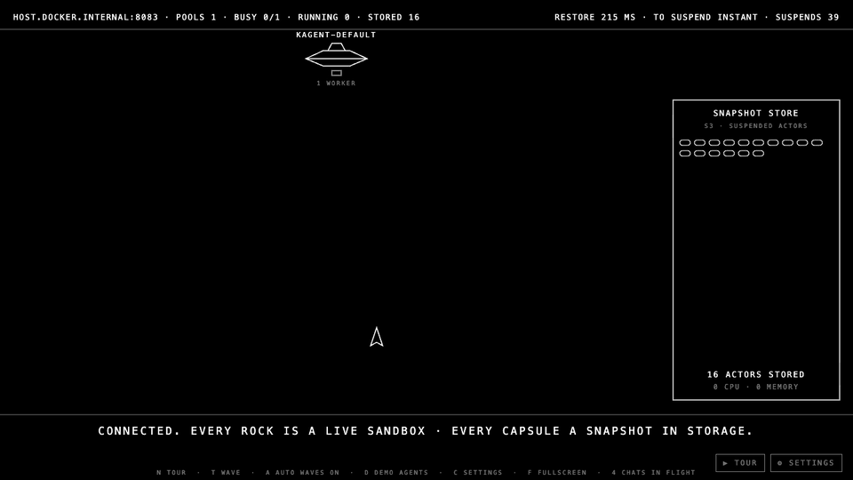
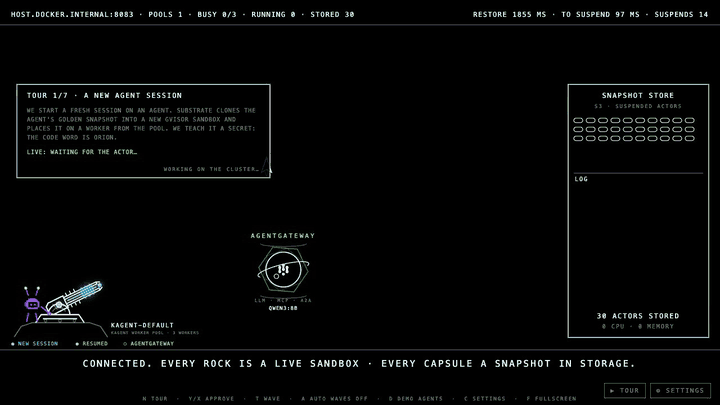

# Substrate Asteroids

A self-running, live show that teaches how **kagent Agent Substrate** works,
drawn as 1979 vector *Asteroids*. Nobody plays: you put it on a screen and
narrate. Every rock, shot and capsule is a real actor or a real state change in
a real cluster, read from the kagent 1.0 API. Press `T` and the app sends a
wave of real chats to your agents. It never chats on its own unless you turn
automatic waves on.



*A wave of real chats on a local kind cluster: four agents launch from the
worker pool's saucer, run on its one worker, and are frozen into the snapshot
store the instant each turn ends.*

## What you're looking at

| On screen | In Agent Substrate |
|-----------|--------------------|
| The kagent robot's rail cannon (bottom left) | a **WorkerPool**; the lights on its platform are its **workers** (lit while hosting an actor) |
| Asteroid fired out of the cannon | an actor being **created** (a new session gets a fresh gVisor sandbox); four rock families (jagged, long, chunky, cratered), each session always the same shape |
| Capsule flying from the store into the cannon, then the same asteroid fired out again | a **resume**: the actor's snapshot is restored onto a worker |
| Asteroid tumbling and growing, labelled `RUNNING ON WORKER …` | an actor **running** a turn (it grows while its sandbox works) |
| The rocket shoots the asteroid down, it breaks up, a capsule drops into the store | a **suspend**: memory and disk are checkpointed to S3 and the worker is freed |
| Grey, dashed, frozen asteroid with the kagent robot pilot holding up a sign | **human in the loop**: the agent asked to run a tool and is suspended (0 CPU) until someone presses `Y` or `X` |
| Snapshot store | every suspended actor, stored at 0 CPU and 0 memory, with a live log underneath |
| Cyan rock / amber rock | a **new** session (cloned from the agent's golden snapshot) / a **resumed** one (restored from its own snapshot, generation shown) |
| Planet with the agentgateway mark, inside a hexagon shield | **agentgateway**, the one gate every model call, MCP tool call and chat in passes through; the models kagent uses are listed under it |
| Dotted shield on a rock + a beam to the planet | a real request agentgateway handled for that agent: a model call, a tool call, or a chat coming in |

The rocket doesn't cause the suspend. Substrate suspends an actor by itself, the
moment its turn ends. On a local kind cluster that's within a few milliseconds
of the reply finishing, and the captions say so. The rocket just marks the moment.

The top bar shows live numbers: busy workers, running and stored actors, the
last restore time (chat sent → actor running), the last time-to-suspend, and
the total number of suspends.

## Guided tour

Press `N` (or click **▶ TOUR**) for a seven-chapter lesson. A card floats over
the live show while each chapter does something real on the cluster:

| Chapter | What happens on the cluster | What it teaches |
|---------|-----------------------------|-----------------|
| 1 · A new agent session | creates a session and tells it "the code word is ORION" | a session is a gVisor sandbox cloned from the agent's golden snapshot |
| 2 · Suspend | nothing: the session has already frozen itself | memory + disk go to S3 the moment a turn ends; 0 CPU while idle |
| 3 · Resume | asks "what was the code word?" | the snapshot is restored onto a worker in ~100 ms and the agent answers ORION: state survived |
| 4 · Fork | checkpoints the session and forks a new one from it, then asks the fork | the asteroid splits in two, and the fork answers ORION too |
| 5 · Agentgateway | asks the agent a cluster question it must use a tool for | its model call and tool call both leave the sandbox through agentgateway (shield + beams); the agent holds no keys |
| 6 · Human in the loop | asks `asteroids-demo-ops` (tools need approval) a cluster question | it pauses to ask; Substrate freezes it (0 CPU) while it waits; its pilot holds up the request; `Y`/`X` resumes it |
| 7 · Density | sends a wave across every agent | sessions hold a worker only while thinking: many agents, few machines |



Rocks the tour is talking about get bracket markers, and the card's last line
is the live state of that actor. `N` steps forward, `Esc` ends the tour.
Automatic waves pause while the tour runs. Tour sessions are named
`asteroids-tour-…`.

## Agentgateway: every call in and out of a sandbox

`make agentgateway` (needs `AGENTGATEWAY_LICENSE_KEY`) installs Solo Enterprise
for agentgateway `v2026.10.0` in the kind cluster and applies
`deploy/agentgateway/`:

- **Model:** agents reach their model only through the gateway. Out of the
  box that's your **Qwen** (`qwen3:8b` on Ollama on this Mac, reached via the
  `ollama-relay` container so Ollama stays bound to localhost), with
  `reasoning_effort: none` so turns take seconds. There is **one** model
  config, kagent's `default-model-config`, pointed at the gateway and holding
  only a placeholder key. An `/openai` route also exists; the real OpenAI key
  lives only in the gateway's `openai-secret`. Swapping models happens in the
  gateway, not in the agents.
- **Tools:** each agent gets kagent's Kubernetes tools (MCP) through the
  gateway.
- **Human in the loop:** `k8s-operator` reads the cluster freely, but every
  change it wants to make in `playground` (scale, rollout, patch, label,
  annotate, delete, apply) waits for a person to approve or reject it, in the kagent UI or in
  the show (Y/X). It is suspended while it waits. It has no exec tool.
- **No Secrets, one sandbox:** kagent's tool server ships as cluster-admin.
  `make agentgateway` narrows it to read-only with no Secrets
  (`deploy/kagent-tools-rbac.yaml`, and the target fails if Secrets are still
  readable). It can change things only in the `playground` namespace (no
  Secrets, restricted Pod Security), so even an approved change can't escalate.
- **Chats in:** the show's chats enter through a separate gateway listener
  (`:8081`) that routes only the A2A service, the session lookup and health
  checks. The sandboxes can't reach it, so agents can't use the gateway to
  reach kagent's API.
- **Enforced, not just configured:** Substrate allow-lists each sandbox's
  egress from its model and tools, so the gateway is the only place an agent
  can reach. Sessions created before the switch keep their old configuration
  baked into their snapshots: delete them.
- **The show sees it:** the gateway sends its OTLP access logs to the app on
  `:4318`, which is only reachable from the kind network. Tool calls carry
  their agent (`x-asteroids-agent` on each agent's tool connection). Model
  calls share one config, so the app pins them to the only running actor, or
  to none when several are busy. A shield appears only for a request the
  gateway really handled.

## Quick start (local kind cluster)

You need kagent 1.0 (tested with `v1.0.0-alpha16` and Substrate `0.6.0-alpha3`)
and Docker.

```bash
make agentgateway   # once: agentgateway in front of every agent
make pf        # terminal 1: port-forward kagent (8083) and agentgateway (8090, 8091)
make image run # terminal 2: build and run the container
open http://localhost:7790
```

`make run` publishes the app on `127.0.0.1` only, because its control API
spends your model budget. Add `LAN_IP=172.16.10.37` to also publish it on
your LAN. If the container can't reach the port-forward,
start the port-forward with
`kubectl port-forward --address 0.0.0.0 -n kagent svc/kagent-controller 8083:8083`.

Without Docker, run `make dev`.

## Keys

| Key | Action |
|-----|--------|
| `N` | start the guided tour / next chapter (`Esc` ends it) |
| `Y` / `X` | approve / reject the tool call a frozen asteroid's pilot is holding up |
| `T` | send a wave of chats now |
| `A` | toggle automatic waves |
| `D` | create three small demo agents (only if the namespace has no ready agents) |
| `C` | settings: connect to another kagent environment (also the **⚙ SETTINGS** button) |
| `F` | fullscreen |

A Stream Deck or script can trigger a wave with
`curl -X POST -H 'Content-Type: application/json' localhost:7790/traffic`.

## Configuration

| Env var | Default | Meaning |
|---------|---------|---------|
| `KAGENT_API` | `http://host.docker.internal:8083` | kagent controller API (gRPC) |
| `KAGENT_GATEWAY` | same as API | A2A endpoint for chats (`make run` uses agentgateway's ingress, `:8091`) |
| `OTLP_LISTEN_ADDR` | `:4318` | where agentgateway's access logs arrive; never publish it |
| `KAGENT_USER_ID` | `admin@kagent.dev` | sent as `x-user-id` |
| `KAGENT_TOKEN` | — | optional bearer token |
| `KAGENT_CA_FILE` | — | CA file for TLS endpoints (mount it into the container) |
| `KAGENT_NAMESPACE` | `kagent` | where agents are listed and demo agents are created |
| `WAVE_INTERVAL` | `20s` | time between automatic waves (when on) |
| `AUTO_WAVES` | `false` | start with automatic waves on; otherwise waves are manual (`T`) |
| `DEMO_AGENTS` | `false` | create demo agents at start if none are ready |
| `LISTEN_ADDR` | `:7790` | HTTP listen address |

## Connecting to any environment

The app only talks to the public kagent 1.0 API. It needs no kubeconfig and
doesn't scrape Substrate's internals. Point `KAGENT_API` at another cluster's
controller, or press `C` while the show is running. Waves only create, chat on,
or delete sessions named `asteroids-…`. Other users' sessions are shown but
never touched.

Time measurements compare this machine's clock with the cluster's. On a remote
cluster with clock skew, readings within 50 ms count as instant.

## Development

```bash
make test   # Go tests (race detector) + node tests for the show logic
go test -tags live ./internal/kagent/ -run Live -v   # against a live cluster on :8083
```

Design: `docs/superpowers/specs/2026-10-20-substrate-asteroids-design.md`.
